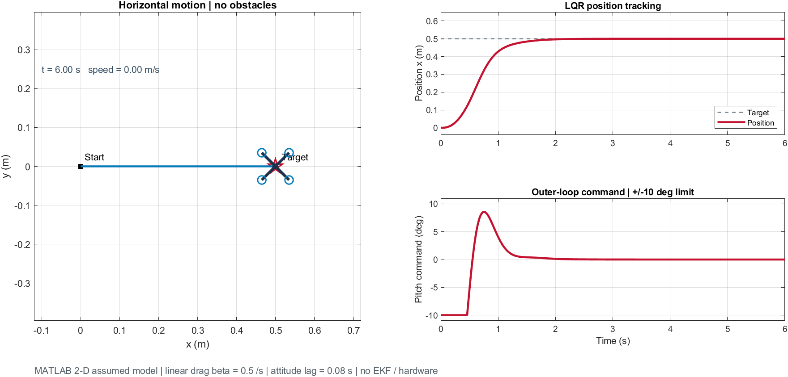

# Hongfei: horizontal LQR prototype

## Tuned MATLAB step test (November 14, 2026)

Run `run_lqr_tuned_demo` in MATLAB from this folder for a live animation and GIF,
or `run_lqr_tuned_demo(false,false)` for an invisible run without GIF export.
Base MATLAB is sufficient; no Control System Toolbox is needed. Outputs are
written to `tuned_results/`. The original scripts below are retained unchanged.



### Conditions and results

- 0.5 m x-position step from rest; y target zero; yaw zero; fixed height; no obstacles.
- 100 Hz control; exact ZOH design; Q = diag(800,800,80,80), R = diag(300,300).
- Assumed linear drag beta = 0.5 /s; assumed first-order attitude lag tau = 0.08 s.
- Per-axis roll/pitch command limits: +/-10 degrees; true-state feedback, no EKF or sensor noise.
- Plant uses tilt-based horizontal acceleration and linear drag, with 0.002 s integration substeps.
- MATLAB result: settling 1.46 s; six-second x tracking RMSE 0.146391 m; no observed overshoot.
- Settling means x error <= 0.03 m and horizontal speed <= 0.05 m/s, maintained through the end of the 6 s run.
- RMSE includes the initial movement and is computed over all 601 logged samples.
- Pitch command reaches the 10-degree limit. Faster tuning increases command effort; it is not evidence of lower energy consumption.

[Raw trace](tuned_results/lqr_drag_log.csv) | [Metrics](tuned_results/metrics.json)

This candidate was selected using nominal and drag/lag sensitivity cases; these
are tuning evidence, not independent robustness validation. Results are from an
assumed 2-D MATLAB plant, not stock inner PID loops, Isaac Sim, or flight.
The first-order lag represents attitude response, not sensor latency.
Firmware gains are unchanged. Validate with estimated feedback, retained inner
controllers, and Kelvin's braking logic before adopting these gains in firmware.
Historical CPU results under docs/Hongfei/results are a different experiment and
must not be combined with these MATLAB metrics.

---


The MATLAB files below remain standalone. The shared C implementation, firmware
switch, navigation velocity interface, and Isaac/PID comparison commands are now
in [START_HERE_HONGFEI.md](../START_HERE_HONGFEI.md).
Host C tests and CPU dynamics have run; PhysX and hardware validation are pending.

Runnable MATLAB design and demonstration for Sprint 1. This is a standalone
horizontal model with assumed parameters and synthetic feedback. These MATLAB
scripts do not themselves call Isaac Sim, the firmware PID, EKF, or navigator.

## Run

In MATLAB, change to this folder and run:

```matlab
week1_model     % design K, simulate 22 s of waypoint holds, print metrics, plot
animate_lqr     % rerun the model and export Hongfei_LQR_demo.mp4 here
```

The design uses base MATLAB matrix operations; Control System Toolbox is not
required. Animation export uses VideoWriter with MPEG-4 and exportgraphics;
MPEG-4 availability depends on the MATLAB platform. Both scripts clear the
current workspace through week1_model. The model leaves a results struct with
the gain, discrete matrices, state/reference histories, commands, and metrics.
Generated videos and MATLAB workspaces are ignored by Git.

## Verification

On 2026-11-06, week1_model.m completed in local MATLAB with its default
configuration. The built-in solver/stability/limit assertions passed and all
waypoint settling times were finite. This verifies the simplified MATLAB run;
the animation was not rerun for this upload and Isaac Sim/hardware were not tested.

## Model and controller

- State: s = [x; y; vx; vy], position in m and velocity in m/s, world frame.
- Command: u = [roll_ref; pitch_ref], radians, Crazyflie legacy Euler signs.
- Assumptions: small tilt, near hover, altitude held externally, still air,
  diagonal linear drag, and fixed yaw = 0 with world/body horizontal axes aligned.
- Dynamics: x_dot = vx; y_dot = vy;
  vx_dot = -g*pitch_ref - beta_x*vx;
  vy_dot = -g*roll_ref - beta_y*vy.
- Design assumes fast attitude tracking. The separate simulated plant adds a
  first-order lag in actual roll and pitch; this is not the stock attitude PID.
- Exact zero-order-hold discretization at Ts = 0.01 s (proposed 100 Hz).
- Discrete Riccati iteration computes K. Command = u_ff - K*(s_est - s_ref),
  followed by a per-axis angle limit.
- For smooth references, u_ff = [-(ay_ref+beta_y*vy_ref);
  -(ax_ref+beta_x*vx_ref)] / g. Current piecewise-constant position holds use
  zero velocity and acceleration references, so u_ff = 0 between switches.

The script checks controllability, the Riccati residual, nominal closed-loop
poles, poles with the assumed attitude lag, finite results, and command limits.
Pole checks concern the unsaturated linear models; they do not establish global
stability under saturation or validate physical flight.

## Parameters to replace or validate

Edit cfg at the top of week1_model.m.

| Setting | Current value | Status |
|---|---|---|
| beta_design / beta_plant | [0.5; 0.5] 1/s | assumed drag per mass, not a measured coefficient |
| attitude_tau | 0.08 s | assumed first-order attitude response |
| Q | diag([20 20 4 4]) | initial tuning |
| R | diag([300 300]) | initial tuning, angle commands in radians |
| angle_limit_deg | 10 degrees on each axis | provisional; not a combined 10-degree tilt bound |
| noise_std | [0.005; 0.005; 0.01; 0.01] | synthetic position/velocity noise |
| waypoint_times | [0 1 6 11 16] s | synthetic reference sequence |
| waypoint_xy | (0,0), (1,0), (1,1), (0,1), (0,0) m | position holds |

The plant currently uses the same drag as the design by default. Set beta_plant
separately for mismatch studies. Attitude lag is not a model of sensor latency.
RMSE includes the transients after waypoint changes. Simulated true state is
used for metrics; noisy feedback is used by the controller.

## Handoff to the shared simulation

The intended integrated architecture is horizontal LQR -> stock attitude/rate
PID -> stock motor mixing, alongside retained stock z-position/z-velocity
control for collective thrust. Gain design stays offline; runtime needs the
state/reference error, matrix multiplication, feedforward, and limits.

Relevant existing modules:
- [firmware PID wrapper](../sim/controllers/firmware_pid.py)
- [EKF/PID composition](../sim/controllers/ekf_pid.py)
- [shared simulation guide](../sim/README.md)
- [Jerry's navigation model](../matlab-trajectory-sim/README.md)

Outstanding interfaces (observed on the Hongfei branch at upload time):
1. The navigator emits body-frame vx/vy, yaw rate, and height. This prototype
   consumes world-frame position/velocity references with yaw fixed at zero.
   Agree on a trajectory adapter or a velocity-tracking controller variant,
   and implement yaw handling before connecting them. A velocity command must
   not be treated as a position waypoint.
2. Read the same estimator output and timing used by the baseline. Replace
   synthetic feedback in the actual control path; retain synthetic noise only
   as an explicit simulation test configuration.
3. The wrapper's attitude_legacy_deg target currently accepts a manual
   collective_command and disables z control. Do not use that mode as an
   automatic altitude-holding LQR interface without modification. Add a path
   that retains stock z control and accepts the LQR's roll/pitch references,
   ensuring the original horizontal PID does not overwrite them.
4. Convert radians to degrees at the legacy attitude interface, confirm signs,
   and execute the horizontal controller at the agreed rate.
5. Remove the prototype's first-order attitude lag from the physical plant
   path when the real attitude/rate controller and rigid-body dynamics are used.
6. Validate position hold, short moves, noise/delay, and drag mismatch against
   stock PID with matched initial states, references, estimator, and limits.
   Report XY RMSE, overshoot, settling time, angle-command effort, saturation,
   and altitude error. Angle-command effort is not electrical energy.
7. Connect navigation/braking priority and validate timing before hardware use.

This upload provides the MATLAB prototype and integration notes. It does not
claim completed Isaac Sim integration, PID comparison, or hardware validation.

## Model references

- [Greiff (2017), Crazyflie thesis](https://lup.lub.lu.se/student-papers/record/8905295/file/8905299.pdf#page=135):
  Appendix A.8, Eqs. A.61-A.63, horizontal rows of the full hover-linearized
  model including translational drag. The four-state angle-reference model is
  our adaptation; fast inner-loop tracking is an additional design assumption.
- [Bitcraze coordinate conventions](https://www.bitcraze.io/documentation/system/platform/cf2-coordinate-system/):
  legacy Euler pitch sign conversion must match the integration interface.
- [MATLAB dlqr equations](https://www.mathworks.com/help/control/ref/lti.dlqr.html):
  discrete Riccati equation and gain formula; this script implements its own
  iteration rather than requiring dlqr.

